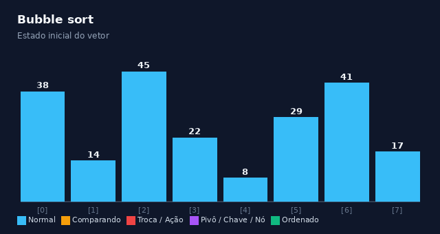
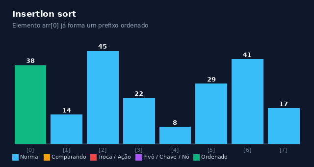
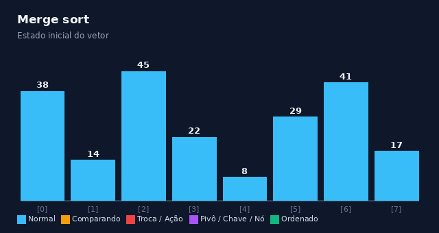

# Algoritmos de ordenação em C

Este documento apresenta a lógica de funcionamento, a análise de complexidade em notação Big O, a implementação em linguagem C e uma animação do fluxo de execução de seis algoritmos de ordenação, organizados do funcionamento mais simples ao mais complexo: Bubble sort, Selection sort, Insertion sort, Merge sort, Quick sort e Heap sort.

## Bubble sort

O Bubble sort percorre o vetor repetidamente comparando elementos vizinhos e efetuando a troca sempre que estão fora de ordem. A cada iteração sobre o vetor, o maior elemento restante do intervalo se desloca para a posição final correspondente. O algoritmo encerra antes se uma varredura inteira ocorrer sem nenhuma troca.

Complexidade de tempo:

- Melhor caso: O(n), quando o vetor já está ordenado e a condição de parada interrompe o laço na primeira passagem.
- Caso médio: O(n²).
- Pior caso: O(n²), quando o vetor está em ordem decrescente.

Espaço auxiliar: O(1).



```c
void bubble_sort(int arr[], int n) {
  int temp;

  // Laço externo: controla o número de passadas pelo vetor.
  // A cada passada 'i', o maior elemento restante do intervalo é "borbulhado"
  // para sua posição final definitiva.
  for (int i = 0; i < n - 1; i++) {
    // Flag de controle: rastreia se alguma troca ocorreu nesta passada.
    // Permite detectar antecipadamente se o vetor já se encontra ordenado.
    int trocou = 0;

    // Laço interno: compara pares adjacentes de elementos.
    // O limite 'n - 1 - i' evita reprocessar os 'i' últimos elementos já ordenados.
    for (int j = 0; j < n - 1 - i; j++) {
      // Se o elemento atual for maior que o seguinte, estão fora de ordem
      if (arr[j] > arr[j + 1]) {
        // Realiza a troca (swap) entre os vizinhos
        temp = arr[j];
        arr[j] = arr[j + 1];
        arr[j + 1] = temp;

        // Sinaliza que uma troca ocorreu nesta passada
        trocou = 1;
      }
    }

    // Se nenhuma troca ocorreu em toda a passagem pelo laço interno,
    // o vetor já está completamente ordenado (otimização para melhor caso O(n)).
    if (!trocou) {
      break;
    }
  }
}
```

## Selection sort

O Selection sort divide o vetor conceitualmente em duas regiões: uma já ordenada e outra não ordenada. A cada passo, o algoritmo identifica o menor elemento presente na porção não ordenada e o troca com o elemento que se encontra no início dessa porção, avançando o limite da região ordenada em uma posição.

Complexidade de tempo:

- Melhor caso: O(n²), pois a verificação percorre todas as comparações restantes independentemente da disposição inicial dos dados.
- Caso médio: O(n²).
- Pior caso: O(n²).

Espaço auxiliar: O(1).


```c
void selection_sort(int arr[], int n) {
  // Laço externo: move a fronteira entre a parte ordenada e a não ordenada.
  // Em cada passo 'i', procura o menor elemento do intervalo [i ... n-1] para fixar em arr[i].
  for (int i = 0; i < n - 1; i++) {
    // Assume inicialmente que o menor elemento está na primeira posição da porção não ordenada
    int min_idx = i;

    // Laço interno: percorre o restante dos elementos não ordenados (i + 1 até n - 1)
    // para encontrar o índice do menor elemento real
    for (int j = i + 1; j < n; j++) {
      // Atualiza o índice do menor elemento se encontrar um valor menor
      if (arr[j] < arr[min_idx]) {
        min_idx = j;
      }
    }

    // Se o menor elemento não estava na posição atual 'i', realiza a troca.
    // Isso garante no máximo (n - 1) operações de escrita no vetor.
    if (min_idx != i) {
      int temp = arr[i];
      arr[i] = arr[min_idx];
      arr[min_idx] = temp;
    }
  }
}
```

## Insertion sort

O Insertion sort constrói o resultado ordenado de modo progressivo. O algoritmo mantém os elementos à esquerda já ordenados e insere cada novo elemento na posição correta dessa partição ordenada, deslocando para a direita os elementos que forem maiores que a chave atual.

Complexidade de tempo:

- Melhor caso: O(n), quando o vetor já está ordenado e cada elemento necessita de apenas uma comparação para validação.
- Caso médio: O(n²).
- Pior caso: O(n²), quando o vetor se encontra em ordem inversa.

Espaço auxiliar: O(1).



```c
void insertion_sort(int arr[], int n) {
  // Começa no índice 1, pois um vetor com apenas 1 elemento (índice 0)
  // já é trivialmente ordenado.
  for (int i = 1; i < n; i++) {
    // Guarda o elemento atual a ser inserido na porção já ordenada à esquerda
    int chave = arr[i];

    // 'j' aponta para o último elemento da porção ordenada (à esquerda de 'i')
    int j = i - 1;

    // Desloca para a direita todos os elementos maiores que a 'chave',
    // abrindo espaço na posição exata onde ela deverá ser inserida.
    while (j >= 0 && arr[j] > chave) {
      arr[j + 1] = arr[j]; // Desloca o elemento uma posição para a frente
      j--;                 // Recua para inspecionar o próximo elemento à esquerda
    }

    // Insere a 'chave' na vaga aberta (imediatamente após onde o laço parou)
    arr[j + 1] = chave;
  }
}
```

## Merge sort

O Merge sort divide o vetor recursivamente em duas metades até obter subvetores de um único elemento. Na sequência, o algoritmo realiza a intercalação (merge) desses subvetores de maneira ordenada, combinando-os sucessivamente até reconstituir o vetor completo ordenado.

Complexidade de tempo:

- Melhor caso: O(n log n).
- Caso médio: O(n log n).
- Pior caso: O(n log n).

Espaço auxiliar: O(n), necessário para alocar as estruturas temporárias durante a etapa de intercalação.



```c
#include <stdlib.h>

// Função auxiliar que intercala duas metades já ordenadas:
// Subvetor esquerdo: arr[esq ... meio]
// Subvetor direito:  arr[meio + 1 ... dir]
static void intercala(int arr[], int esq, int meio, int dir) {
  // Calcula o tamanho de cada metade
  int n1 = meio - esq + 1;
  int n2 = dir - meio;

  // Aloca memória temporária para armazenar as duas metades
  int *L = (int *)malloc(n1 * sizeof(int));
  int *R = (int *)malloc(n2 * sizeof(int));

  // Validação: se houver falha na alocação, libera os recursos e encerra com segurança
  if (!L || !R) {
    free(L);
    free(R);
    return;
  }

  // Copia os dados da metade esquerda do vetor principal para o vetor temporário L
  for (int i = 0; i < n1; i++) {
    L[i] = arr[esq + i];
  }
  // Copia os dados da metade direita do vetor principal para o vetor temporário R
  for (int j = 0; j < n2; j++) {
    R[j] = arr[meio + 1 + j];
  }

  // Índices para iterar por L (i), R (j) e a posição de escrita no vetor original (k)
  int i = 0, j = 0, k = esq;

  // Compara os elementos de L e R e insere o menor de volta no vetor original 'arr'.
  // O uso de '<=' garante que o Merge sort preserve a estabilidade relativa de chaves iguais.
  while (i < n1 && j < n2) {
    if (L[i] <= R[j]) {
      arr[k++] = L[i++];
    } else {
      arr[k++] = R[j++];
    }
  }

  // Copia os elementos restantes de L, se houver
  while (i < n1) {
    arr[k++] = L[i++];
  }

  // Copia os elementos restantes de R, se houver
  while (j < n2) {
    arr[k++] = R[j++];
  }

  // Libera a memória alocada dinamicamente para os vetores auxiliares
  free(L);
  free(R);
}

// Função principal recursiva do Merge sort
void merge_sort(int arr[], int esq, int dir) {
  // Caso base: continua somente se o intervalo contiver 2 ou mais elementos (esq < dir)
  if (esq < dir) {
    // Calcula o ponto de divisão evitando overflow aritmético em vetores extensos
    int meio = esq + (dir - esq) / 2;

    // Divisão: ordena recursivamente a metade esquerda
    merge_sort(arr, esq, meio);

    // Divisão: ordena recursivamente a metade direita
    merge_sort(arr, meio + 1, dir);

    // Conquista: combina as duas metades agora ordenadas
    intercala(arr, esq, meio, dir);
  }
}
```

## Quick sort

O Quick sort opera pelo princípio de divisão e conquista. O algoritmo seleciona um elemento como pivô e particiona o vetor de forma que elementos menores ou iguais ao pivô fiquem à esquerda e elementos maiores fiquem à direita. Em seguida, aplica o mesmo procedimento recursivamente às duas partições.

Complexidade de tempo:

- Melhor caso: O(n log n), ocorre quando o pivô divide o vetor em duas metades de tamanhos equivalentes.
- Caso médio: O(n log n).
- Pior caso: O(n²), ocorre quando o pivô selecionado é repetidamente o menor ou o maior elemento da partição (comum ao selecionar o último elemento em vetores já ordenados).

Espaço auxiliar: O(log n) no caso médio e O(n) no pior caso, referente à pilha de chamadas da recursão.


```c
// Função auxiliar de particionamento (Esquema de Lomuto).
// Posiciona o pivô no seu índice final ordenado e garante que:
// elementos <= pivô fiquem à esquerda, e elementos > pivô fiquem à direita.
static int particiona(int arr[], int inicio, int fim) {
  // Define o pivô como sendo o último elemento do intervalo
  int pivo = arr[fim];

  // 'i' rastreia a fronteira dos elementos menores ou iguais ao pivô.
  // Inicia uma posição antes do início do intervalo.
  int i = inicio - 1;
  int temp;

  // Percorre os elementos do intervalo de 'inicio' até 'fim - 1'
  for (int j = inicio; j < fim; j++) {
    // Se o elemento atual for menor ou igual ao pivô, pertence à partição esquerda
    if (arr[j] <= pivo) {
      i++; // Expande a fronteira dos elementos menores

      // Troca arr[i] com arr[j], colocando o menor elemento na partição esquerda
      temp = arr[i];
      arr[i] = arr[j];
      arr[j] = temp;
    }
  }

  // Coloca o pivô em seu lugar definitivo (logo após o último elemento da partição menor)
  temp = arr[i + 1];
  arr[i + 1] = arr[fim];
  arr[fim] = temp;

  // Retorna a posição definitiva do pivô
  return i + 1;
}

// Função principal recursiva do Quick sort
void quick_sort(int arr[], int inicio, int fim) {
  // Caso base: continua enquanto o intervalo contiver pelo menos 2 elementos (inicio < fim)
  if (inicio < fim) {
    // Particiona o vetor e obtém o índice onde o pivô ficou consolidado
    int p = particiona(arr, inicio, fim);

    // Chamada recursiva para a partição à esquerda do pivô (sem incluir o pivô)
    quick_sort(arr, inicio, p - 1);

    // Chamada recursiva para a partição à direita do pivô (sem incluir o pivô)
    quick_sort(arr, p + 1, fim);
  }
}
```

## Heap sort

O Heap sort utiliza a estrutura de dados max-heap para ordenar os elementos. Na primeira fase, o vetor é transformado em um heap máximo, onde cada nó pai armazena um valor maior ou igual ao de seus filhos. Na segunda fase, a raiz (maior valor) é sucessivamente trocada com a última posição válida do vetor, reduz-se o tamanho considerado do heap e restaura-se a propriedade de heap na nova raiz.

Complexidade de tempo:

- Melhor caso: O(n log n).
- Caso médio: O(n log n).
- Pior caso: O(n log n).

Espaço auxiliar: O(1), pois a ordenação ocorre diretamente no próprio vetor (in-place).


```c
// Função auxiliar que restaura a propriedade de max-heap em uma subárvore com raiz no índice 'i'.
// 'n' representa a quantidade de elementos considerados no heap ativo.
static void heapify(int arr[], int n, int i) {
  int maior = i;            // Inicialmente assume o nó raiz como o maior
  int esq = 2 * i + 1;      // Índice do filho esquerdo na representação em vetor (base 0)
  int dir = 2 * i + 2;      // Índice do filho direito na representação em vetor (base 0)
  int temp;

  // Verifica se o filho esquerdo existe no heap e se possui valor maior que o da raiz
  if (esq < n && arr[esq] > arr[maior]) {
    maior = esq;
  }

  // Verifica se o filho direito existe no heap e se possui valor maior que o maior atual
  if (dir < n && arr[dir] > arr[maior]) {
    maior = dir;
  }

  // Se o maior elemento não for a raiz 'i', propaga o maior para cima e rebaixa a raiz (sift-down)
  if (maior != i) {
    // Efetua a troca entre a raiz e o maior dos seus filhos
    temp = arr[i];
    arr[i] = arr[maior];
    arr[maior] = temp;

    // Chama recursivamente heapify na subárvore afetada para garantir a propriedade do heap
    heapify(arr, n, maior);
  }
}

// Função principal do Heap sort
void heap_sort(int arr[], int n) {
  int temp;

  // Fase 1: Constrói o max-heap a partir do vetor desordenado.
  // Começa no último nó interno (n / 2 - 1), ou seja, o último nó com ao menos um filho,
  // e sobe até a raiz (índice 0), aplicando heapify em cada um.
  for (int i = n / 2 - 1; i >= 0; i--) {
    heapify(arr, n, i);
  }

  // Fase 2: Extração ordenada dos elementos do heap.
  // A cada passo, a raiz arr[0] (que contém o maior elemento do heap) é transferida
  // para o final do vetor (posição 'i').
  for (int i = n - 1; i > 0; i--) {
    // Move o maior elemento atual (raiz) para sua posição ordenada definitiva no fim
    temp = arr[0];
    arr[0] = arr[i];
    arr[i] = temp;

    // Reduz o tamanho do heap considerado para 'i' e restaura o max-heap a partir da nova raiz
    heapify(arr, i, 0);
  }
}
```

## Comparação entre os algoritmos

| Algoritmo      | Melhor caso | Caso médio | Pior caso  | Espaço auxiliar | Estável | Cenário ideal                                                                                                                                                                                   |
| :------------- | :---------- | :--------- | :--------- | :-------------- | :------ | :---------------------------------------------------------------------------------------------------------------------------------------------------------------------------------------------- |
| Bubble sort    | O(n)        | O(n²)      | O(n²)      | O(1)            | Sim     | Fins didáticos para explicação conceitual de ordenação por comparações e trocas locais em listas muito pequenas.                                                                                |
| Selection sort | O(n²)       | O(n²)      | O(n²)      | O(1)            | Não     | Cenários onde a operação de escrita na memória tem custo muito mais elevado do que a leitura (como certas memórias flash), pois o algoritmo realiza no máximo n trocas.                         |
| Insertion sort | O(n)        | O(n²)      | O(n²)      | O(1)            | Sim     | Vetores pequenos (geralmente abaixo de 30 a 50 elementos) ou conjuntos de dados que já estão quase ordenados, servindo também como etapa final em algoritmos híbridos como Introsort e Timsort. |
| Merge sort     | O(n log n)  | O(n log n) | O(n log n) | O(n)            | Sim     | Situações onde a estabilidade dos dados é obrigatória, ordenação de listas encadeadas, garantia estrita de tempo O(n log n) no pior caso e ordenação externa de arquivos em disco.              |
| Quick sort     | O(n log n)  | O(n log n) | O(n²)      | O(log n)        | Não     | Vetores genéricos em memória RAM onde o tempo de execução na prática é prioritário e a estabilidade não é necessária.                                                                           |
| Heap sort      | O(n log n)  | O(n log n) | O(n log n) | O(1)            | Não     | Ambientes com limite estrito de memória auxiliar e sistemas de tempo real que necessitam de garantia determinística de tempo O(n log n) no pior caso sem consumo de memória adicional.          |
