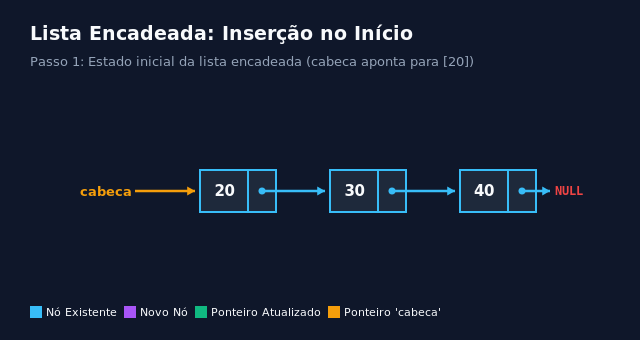
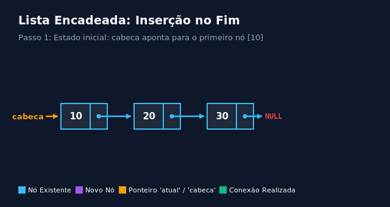
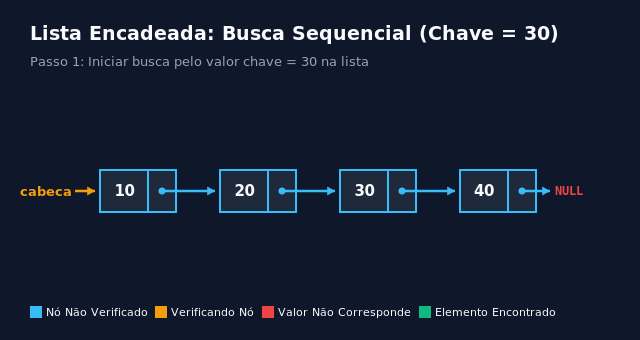
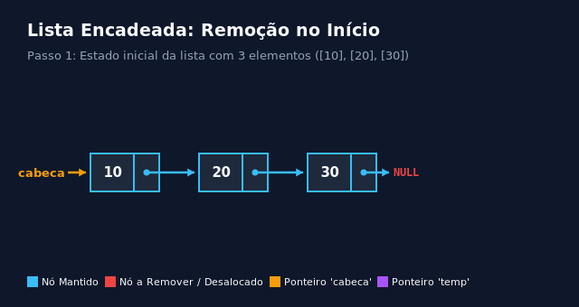

# Listas encadeadas em C

Este documento apresenta a lógica de funcionamento, a modelagem de estruturas autorreferenciadas, a análise de complexidade temporal e espacial em notação Big O, a implementação detalhada em linguagem C e animações do fluxo de execução das operações fundamentais sobre listas simplesmente encadeadas: conceito e estrutura do nó autorreferenciado, inserção no início, inserção no fim, busca sequencial de elementos, remoção de nós e destruição completa da lista.

## Estrutura do nó e conceito de autorreferência

Uma lista simplesmente encadeada é uma estrutura de dados linear e dinâmica composta por uma sequência de elementos chamados **nós**. Diferentemente de um vetor (onde os elementos estão armazenados de forma estritamente contígua na memória), os nós de uma lista encadeada são alocados individualmente na memória *Heap* e podem estar espalhados em endereços arbitrários. A ligação entre os nós é mantida exclusivamente através de ponteiros.

O mecanismo em linguagem C que torna isso possível é a **estrutura autorreferenciada**: uma `struct` que contém, entre seus campos, um ponteiro que aponta para uma estrutura do **mesmo tipo**.

Regras essenciais da autorreferência:
- Obrigatoriedade do ponteiro: o nó **não pode** conter uma instância direta de si mesmo por valor (ex.: `struct No proximo;`), pois isso criaria uma definição recursiva de tamanho infinito que o compilador não consegue dimensionar. O campo deve ser obrigatoriamente um **ponteiro** (`struct No *proximo;`), cujo tamanho é fixo e conhecido pelo compilador (4 bytes em arquiteturas de 32 bits, 8 bytes em 64 bits).
- Preservação da *tag*: a identificação `struct No` no cabeçalho é necessária para que o campo ponteiro interno consiga referenciar o tipo antes do encerramento da definição do `typedef`.
- Ponteiro `cabeca` (Head): a lista é representada externamente por um simples ponteiro para o primeiro nó da cadeia. Se a lista estiver vazia, esse ponteiro terá o valor `NULL`.
- Final da lista: o último nó da cadeia é identificado quando o seu ponteiro `proximo` armazena o valor `NULL`.

Espaço auxiliar: cada nó consome `sizeof(Dado) + sizeof(Ponteiro)` bytes mais eventuais bytes de alinhamento (*padding*). Para $n$ elementos, a memória total é $O(n)$.

```c
#include <stdio.h>
#include <stdlib.h>

// Definição da estrutura autorreferenciada do nó.
// 'struct No' é a tag necessária para declarar o ponteiro interno 'proximo'.
// 'No' é o tipo simplificado definido via typedef.
typedef struct No {
  int valor;             // Dado numérico armazenado no nó (carga útil)
  struct No *proximo;    // Ponteiro autorreferenciado para o próximo nó da lista
} No;

// Função utilitária para imprimir todos os elementos da lista na saída padrão
void imprimir_lista(const No *cabeca) {
  // Ponteiro auxiliar para percorrer a lista sem alterar o endereço da 'cabeca'
  const No *atual = cabeca;

  printf("Lista: ");
  // Percorre os nós sequencialmente até atingir o fim demarcado por NULL
  while (atual != NULL) {
    printf("[%d] -> ", atual->valor);
    atual = atual->proximo; // Avança o ponteiro auxiliar para o próximo nó
  }
  printf("NULL\n");
}

int main(void) {
  // Uma lista encadeada vazia é representada por um ponteiro nulo (NULL)
  No *lista = NULL;

  imprimir_lista(lista); // Saída: Lista: NULL

  return 0;
}
```

## Inserção no início

A inserção no início adiciona um novo elemento antes do primeiro nó atual da lista, tornando o novo nó a nova "cabeça" (*head*). Esta é a operação de inserção mais eficiente em listas encadeadas, pois não requer percorrer nenhum dos elementos já existentes.

Passos do algoritmo:
1. Aloca um novo nó na Heap via `malloc(sizeof(No))`.
2. Atribui o valor desejado ao novo nó.
3. Faz o ponteiro `novo->proximo` apontar para a cabeça atual da lista (`cabeca`).
4. Atualiza o ponteiro `cabeca` para que aponte para o novo nó alocado.

Complexidade de tempo:
- Melhor caso: O(1).
- Caso médio: O(1).
- Pior caso: O(1), pois a operação realiza um número constante de instruções independentemente do tamanho da lista.

Espaço auxiliar: O(1).



```c
// Insere um novo nó contendo 'valor' no início da lista.
// Retorna o ponteiro para a nova cabeça da lista encadeada.
No* inserir_inicio(No *cabeca, int valor) {
  // 1. Aloca memória na Heap para o novo nó
  No *novo = (No *)malloc(sizeof(No));

  // Validação defensiva: verifica se a alocação de memória falhou
  if (novo == NULL) {
    fprintf(stderr, "Erro de memória ao alocar novo nó.\n");
    return cabeca; // Mantém a lista no estado anterior sem alterações
  }

  // 2. Preenche a carga útil do novo nó
  novo->valor = valor;

  // 3. Conecta o novo nó à cabeça atual da lista.
  // Se a lista estiver vazia (cabeca == NULL), novo->proximo receberá NULL corretamente.
  novo->proximo = cabeca;

  // 4. Retorna o novo nó como sendo a nova cabeça da lista
  return novo;
}
```

## Inserção no fim

A inserção no fim adiciona um novo nó após o último elemento existente na lista. Como a lista simplesmente encadeada convencional mantém referência direta apenas para a sua cabeça, é necessário percorrer toda a cadeia de ponteiros até localizar o nó cujo campo `proximo` é igual a `NULL`.

Passos do algoritmo:
1. Aloca o novo nó na Heap e define `novo->proximo = NULL` (pois ele será o último nó).
2. Se a lista estiver vazia (`cabeca == NULL`), o novo nó torna-se a própria cabeça e a função retorna `novo`.
3. Se a lista não estiver vazia, utiliza um ponteiro auxiliar `atual` para percorrer a lista enquanto `atual->proximo != NULL`.
4. Ao alcançar o último nó, conecta o seu ponteiro ao novo nó: `atual->proximo = novo`.

Complexidade de tempo:
- Melhor caso: O(1), quando a lista está vazia e nenhuma iteração é necessária.
- Caso médio: O(n).
- Pior caso: O(n), pois é necessário visitar todos os $n$ nós para encontrar o final da cadeia.

Espaço auxiliar: O(1).



```c
// Insere um novo nó contendo 'valor' no final da lista.
// Retorna o ponteiro para a cabeça da lista.
No* inserir_fim(No *cabeca, int valor) {
  // 1. Aloca memória na Heap para o novo nó
  No *novo = (No *)malloc(sizeof(No));
  if (novo == NULL) {
    fprintf(stderr, "Erro de memória ao alocar novo nó.\n");
    return cabeca;
  }

  // 2. Inicializa os campos do novo nó. Como será o último, seu 'proximo' é NULL.
  novo->valor = valor;
  novo->proximo = NULL;

  // 3. Caso especial: lista inicialmente vazia
  if (cabeca == NULL) {
    return novo; // O novo nó passa a ser a própria cabeça da lista
  }

  // 4. Caso geral: percorre a lista com um ponteiro auxiliar até encontrar o último nó
  No *atual = cabeca;
  while (atual->proximo != NULL) {
    atual = atual->proximo; // Avança até o nó cujo 'proximo' aponta para NULL
  }

  // 5. Liga o último nó existente ao novo nó
  atual->proximo = novo;

  // A cabeça original da lista não é alterada
  return cabeca;
}
```

## Busca sequencial de elementos

A busca em uma lista encadeada verifica se um determinado valor está presente entre seus nós. Devido à natureza não contígua dos nós e à ausência de índices numéricos diretos, a busca requer a travessia sequencial elemento por elemento a partir da cabeça da lista.

Passos do algoritmo:
1. Inicializa um ponteiro auxiliar `atual` apontando para `cabeca`.
2. Enquanto `atual != NULL`:
   - Compara `atual->valor` com a chave de busca.
   - Se for igual, retorna o ponteiro para o nó correspondente.
   - Se for diferente, avança: `atual = atual->proximo`.
3. Se o laço terminar sem encontrar a chave (atingiu `NULL`), retorna `NULL` para sinalizar que o elemento não está na lista.

Complexidade de tempo:
- Melhor caso: O(1), ocorre quando o elemento procurado está logo no primeiro nó (cabeça).
- Caso médio: O(n).
- Pior caso: O(n), ocorre quando o elemento está no último nó ou não pertence à lista.

Espaço auxiliar: O(1).



```c
// Busca um nó contendo a 'chave' especificada.
// Retorna o ponteiro para o nó encontrado, ou NULL caso o elemento não exista.
No* buscar(No *cabeca, int chave) {
  No *atual = cabeca;

  // Itera pela lista enquanto houver nós válidos
  while (atual != NULL) {
    // Se o valor do nó atual corresponder à chave, retorna o ponteiro do nó
    if (atual->valor == chave) {
      return atual;
    }
    // Caso contrário, avança para o próximo nó da cadeia
    atual = atual->proximo;
  }

  // Elemento não encontrado na lista
  return NULL;
}
```

## Remoção de nós

A remoção consiste em desvincular um nó da cadeia de ponteiros e desalocar explicitamente sua memória na Heap através da função `free()`. Existem duas formas fundamentais de remoção: a **remoção no início** (elimina o primeiro elemento) e a **remoção por valor** (busca e remove a primeira ocorrência de uma chave arbitrária).

### Remoção no início

Passos do algoritmo:
1. Verifica se a lista está vazia (`cabeca == NULL`). Se estiver, não há nada a remover.
2. Salva o endereço da cabeça atual em um ponteiro temporário: `temp = cabeca`.
3. Avança a cabeça da lista para o segundo nó: `cabeca = cabeca->proximo`.
4. Libera a memória do nó salvo: `free(temp)`.
5. Retorna a nova cabeça.

Complexidade de tempo:
- Melhor caso: O(1).
- Caso médio: O(1).
- Pior caso: O(1).

Espaço auxiliar: O(1).



```c
// Remove o primeiro nó da lista encadeada.
// Retorna o ponteiro para a nova cabeça da lista.
No* remover_inicio(No *cabeca) {
  // Se a lista já estiver vazia, não há o que remover
  if (cabeca == NULL) {
    return NULL;
  }

  // Salva o endereço do nó que será removido
  No *temp = cabeca;

  // Avança a cabeça da lista para o segundo nó da cadeia
  cabeca = cabeca->proximo;

  // Libera a memória do antigo primeiro nó na Heap
  free(temp);

  // Retorna a nova cabeça da lista
  return cabeca;
}
```

### Remoção por valor

Para remover um nó intermediário ou final, é necessário utilizar dois ponteiros durante a varredura (`anterior` e `atual`). Isso permite religar o ponteiro `anterior->proximo` diretamente ao nó `atual->proximo`, "pulando" o nó que será destruído.

Complexidade de tempo:
- Melhor caso: O(1), quando o nó a ser removido é a própria cabeça.
- Caso médio: O(n).
- Pior caso: O(n), quando o nó está no final ou não existe.

Espaço auxiliar: O(1).

```c
// Remove a primeira ocorrência de um nó contendo 'valor'.
// Retorna o ponteiro para a cabeça da lista (que pode ter mudado).
No* remover_valor(No *cabeca, int valor) {
  // Caso 1: Lista vazia
  if (cabeca == NULL) {
    return NULL;
  }

  // Caso 2: O nó a ser removido é a própria cabeça
  if (cabeca->valor == valor) {
    No *temp = cabeca;
    cabeca = cabeca->proximo; // Avança a cabeça
    free(temp);               // Libera a cabeça antiga
    return cabeca;
  }

  // Caso 3: O nó a ser removido está no meio ou no fim da lista.
  // Utiliza dois ponteiros para rastrear o nó atual e o seu predecessor.
  No *anterior = cabeca;
  No *atual = cabeca->proximo;

  // Avança enquanto houver nós e o valor não tiver sido encontrado
  while (atual != NULL && atual->valor != valor) {
    anterior = atual;
    atual = atual->proximo;
  }

  // Se 'atual' não for NULL, o elemento foi localizado
  if (atual != NULL) {
    // Religa o nó anterior diretamente ao nó seguinte do atual
    anterior->proximo = atual->proximo;

    // Desaloca a memória do nó removido
    free(atual);
  }

  return cabeca;
}
```

## Destruição completa da lista

Como cada nó de uma lista encadeada foi alocado individualmente na memória Heap com `malloc`, o encerramento do programa ou o descarte da estrutura exige a liberação explícita de **todos os nós**. A desalocação deve salvar o endereço do próximo elemento antes de liberar o elemento atual, para evitar o uso de ponteiros inválidos (*dangling pointers*).

Complexidade de tempo:
- Melhor caso: O(1), se a lista já estiver vazia.
- Caso médio: O(n).
- Pior caso: O(n), proporcional ao total de $n$ nós a serem liberados.

Espaço auxiliar: O(1).

```c
// Desaloca todos os nós da lista encadeada na Heap sequencialmente.
void destruir_lista(No *cabeca) {
  No *atual = cabeca;

  // Percorre a lista liberando nó por nó
  while (atual != NULL) {
    // IMPORTANTE: Salva a referência para o próximo nó ANTES de liberar o nó atual
    No *temp = atual->proximo;

    // Libera a memória do nó atual
    free(atual);

    // Avança para o próximo nó que foi previamente salvo
    atual = temp;
  }
}
```

## Comparação entre lista encadeada e vetores

| Operação / Característica | Vetor (Array Estático / Dinâmico) | Lista Simplesmente Encadeada | Vencedor / Cenário Recomendado |
| :--- | :--- | :--- | :--- |
| **Acesso por índice (`arr[i]`)** | **O(1)** (acesso direto em tempo constante) | **O(n)** (necessita percorrer $i$ nós sequencialmente) | **Vetor**: ideal para consultas aleatórias frequentes. |
| **Inserção no início** | **O(n)** (requer deslocar todos os elementos para a direita) | **O(1)** (basta criar o nó e redirecionar dois ponteiros) | **Lista**: superior quando o início sofre inserções constantes. |
| **Inserção no fim** | **O(1)** amortizado (no vetor dinâmico com capacidade livre) | **O(n)** (ou **O(1)** se a lista mantiver um ponteiro para a cauda) | **Vetor**: mais eficiente sem exigir estrutura auxiliar extra. |
| **Remoção no início** | **O(n)** (requer deslocar todos os elementos para a esquerda) | **O(1)** (basta avançar a cabeça e liberar o nó antigo) | **Lista**: excelente para estruturas do tipo Pilha (*Stack*) ou Fila (*Queue*). |
| **Remoção no meio / fim** | **O(n)** (busca + deslocamento em bloco) | **O(n)** (busca linear + ajuste de ponteiros) | **Empate em Big O**: o vetor pode ser mais rápido na prática pela localidade de cache. |
| **Localidade de referência (Cache)** | **Alta**: elementos ocupam bytes adjacentes na memória física | **Baixa**: nós espalhados na Heap aumentam falhas de cache (*cache misses*) | **Vetor**: muito mais amigável à hierarquia de memória moderna. |
| **Sobrecusto de memória (*Overhead*)** | **Zero**: apenas os dados úteis ocupam espaço | **1 ponteiro por nó**: 4 ou 8 bytes extras de ponteiro para cada valor armazenado | **Vetor**: menor consumo por elemento. |
| **Flexibilidade de redimensionamento** | **Rígida**: requer realocação em bloco com `realloc` e cópia de dados | **Totalmente dinâmica**: cresce e encolhe sob demanda nó a nó | **Lista**: ideal quando a quantidade final de elementos é imprevisível. |

### Armadilhas comuns a serem evitadas

1. **Perda de referência à cabeça da lista**: ao iterar pela lista, nunca utilize a variável `cabeca` diretamente (ex.: `while (cabeca != NULL) cabeca = cabeca->proximo;`). Isso perde o endereço do início da lista permanentemente. Use sempre um ponteiro auxiliar: `No *atual = cabeca;`.
2. **Desreferenciar ponteiro nulo (`NULL pointer dereference`)**: acessar `atual->proximo` sem antes certificar-se de que `atual != NULL` causa falha de segmentação (*Segmentation fault*).
3. **Liberar o nó antes de ler o próximo endereço**: fazer `free(atual); atual = atual->proximo;` é comportamento indefinido, pois lê memória que acabou de ser devolvida ao sistema operacional. Sempre guarde `temp = atual->proximo` antes do `free`.
4. **Esquecer de atualizar o ponteiro externo após a destruição**: após invocar `destruir_lista(lista);`, atribua `lista = NULL;` para evitar ponteiros soltos (*dangling pointers*).

