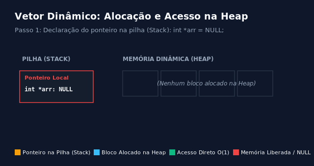
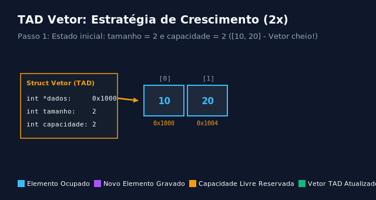

# Vetores com alocação dinâmica em C

Este documento apresenta a lógica de funcionamento, a organização de memória (Stack vs. Heap), a análise de complexidade temporal e espacial em notação Big O, a implementação detalhada em linguagem C e animações do fluxo de execução das operações essenciais com vetores dinâmicos: alocação básica e acesso contíguo com `malloc` e `free`, alocação inicializada com `calloc`, redimensionamento seguro com `realloc`, implementação de um Tipo Abstrato de Dados (TAD) de Vetor Dinâmico com crescimento geométrico, alocação de matrizes bidimensionais, tabela comparativa com outras estruturas e armadilhas comuns.

## Organização de memória: Pilha (Stack) vs. Memória Dinâmica (Heap)

Na linguagem C, variáveis locais e vetores estáticos residem na **Pilha** (*Stack*), uma região de memória gerenciada automaticamente pelo compilador. Embora o acesso à pilha seja extremamente rápido, ela impõe duas restrições fundamentais:
1. **Tamanho fixo**: a dimensão do vetor estático deve ser conhecida em tempo de compilação ou fixada no momento da declaração (no caso de VLAs em C99), não podendo crescer ou encolher posteriormente.
2. **Capacidade limitada**: a pilha possui tamanho reduzido (geralmente poucos megabytes). Declarar vetores muito extensos na pilha causa **estouro de pilha** (*stack overflow*) e encerra o programa abruptamente.
3. **Escopo restrito**: a memória alocada na pilha é automaticamente destruída assim que o fluxo de execução sai do bloco ou da função onde foi declarada.

A **Memória Dinâmica** (*Heap*) resolve essas limitações: é uma área vasta de memória onde o programador pode requisitar blocos de tamanho arbitrário em tempo de execução, decidir exatamente quando redimensioná-los e controlar o momento exato de sua devolução ao sistema operacional.

| Característica | Vetor Estático (Pilha / Stack) | Vetor Dinâmico (Heap) |
| :--- | :--- | :--- |
| **Definição de tamanho** | Tempo de compilação ou entrada no escopo | Tempo de execução sob demanda |
| **Gerenciamento** | Automático pelo compilador | Manual pelo programador (`malloc`/`free`) |
| **Capacidade disponível** | Reduzida (risco de *stack overflow*) | Vasta (limitada pela memória RAM física/virtual) |
| **Redimensionamento** | Impossível após a declaração | Possível a qualquer momento com `realloc` |
| **Ciclo de vida** | Encerra ao sair do escopo da função | Persiste até a chamada explícita de `free` |

---

## Alocação básica com malloc e liberação com free

A função `malloc` (*memory allocation*) requisita ao sistema operacional um bloco contíguo de memória com um número específico de bytes. Ela retorna um ponteiro genérico (`void *`) apontando para o primeiro byte do bloco alocado, ou `NULL` caso a memória disponível seja insuficiente.

Pontos fundamentais:
- **Cálculo de bytes**: deve-se sempre multiplicar o número de elementos pelo operador `sizeof(Tipo)` (por exemplo, `n * sizeof(int)`), garantindo portabilidade entre diferentes arquiteturas de processadores.
- **Valores indeterminados**: o `malloc` apenas reserva o espaço; ele **não inicializa** os bytes alocados. Os valores iniciais são indefinidos (lixo de memória residual).
- **Acesso indexado contíguo**: como a memória alocada é rigorosamente contígua, o acesso por colchetes `arr[i]` funciona com a mesma sintaxe e desempenho de um vetor comum, correspondendo à aritmética de ponteiros `*(arr + i)`.
- **A função `free`**: devolve o bloco de memória ao sistema operacional. É boa prática atribuir `NULL` ao ponteiro imediatamente após o `free`, evitando que ele permaneça como um ponteiro solto (*dangling pointer*).

Complexidade de tempo:
- Alocação com `malloc`: O(1) na prática.
- Acesso/Escrita por índice (`arr[i]`): O(1) com cálculo direto de endereço base + deslocamento.
- Desalocação com `free`: O(1).

Espaço auxiliar: O(1) além do bloco contíguo de tamanho $n \times \text{sizeof(Tipo)}$.



```c
#include <stdio.h>
#include <stdlib.h>

void exemplo_malloc(void) {
  int n = 4;

  // 1. Requisita 16 bytes contíguos na Heap (4 elementos * 4 bytes cada)
  int *arr = (int *)malloc(n * sizeof(int));

  // 2. Validação obrigatória: verifica se a alocação foi bem-sucedida
  if (arr == NULL) {
    fprintf(stderr, "Erro: memória insuficiente na Heap.\n");
    return;
  }

  // 3. Inicializa os elementos através do operador colchetes arr[i]
  for (int i = 0; i < n; i++) {
    arr[i] = (i + 1) * 10; // arr[0] = 10, arr[1] = 20, arr[2] = 30, arr[3] = 40
  }

  // 4. Acesso direto em tempo constante O(1):
  // A expressão arr[2] é estritamente equivalente a *(arr + 2)
  printf("Elemento no índice 2: %d\n", arr[2]);
  printf("Endereço base (índice 0): %p\n", (void *)&arr[0]);
  printf("Endereço do índice 2:     %p\n", (void *)&arr[2]);

  // 5. Desaloca a memória reservada na Heap
  free(arr);

  // 6. Boa prática defensiva: anula o ponteiro para evitar uso acidental após o free
  arr = NULL;
}
```

---

## Alocação inicializada com calloc

A função `calloc` (*contiguous allocation*) aloca memória de forma semelhante ao `malloc`, porém com duas distinções cruciais:
1. **Assinatura com dois parâmetros**: recebe a quantidade de elementos e o tamanho individual de cada elemento separadamente (`calloc(quantidade, tamanho_individual)`).
2. **Inicialização zerada**: garante que **todos os bits** do bloco alocado sejam preenchidos com o valor zero (`0`).

Quando utilizar:
- Use `calloc` quando precisar que os elementos comecem garantidamente zerados (como contadores, matrizes de adjacência, tabelas de frequência ou acumuladores numéricos).
- Use `malloc` quando os valores forem sobrescritos ou preenchidos imediatamente em seguida, economizando o custo de varredura de inicialização de bytes.

Complexidade de tempo:
- Alocação e zeramento: O(n), proporcional ao total de bytes que precisam ser gravados com zero.
- Acesso/Escrita por índice: O(1).
- Desalocação: O(1).

```c
#include <stdio.h>
#include <stdlib.h>

void exemplo_calloc(void) {
  int n = 5;

  // Aloca espaço para 5 inteiros e zera todos os bytes correspondentes
  int *contador = (int *)calloc(n, sizeof(int));

  // Validação obrigatória de alocação
  if (contador == NULL) {
    fprintf(stderr, "Falha na alocação com calloc.\n");
    return;
  }

  // Todos os elementos já iniciam com o valor 0 garantido
  printf("Valores iniciais com calloc: ");
  for (int i = 0; i < n; i++) {
    printf("%d ", contador[i]); // Saída: 0 0 0 0 0
  }
  printf("\n");

  // Liberação da memória
  free(contador);
  contador = NULL;
}
```

---

## Redimensionamento dinâmico com realloc

A função `realloc` (*re-allocation*) permite alterar o tamanho de um bloco de memória previamente alocado na Heap, aumentando ou diminuindo sua capacidade sem perder os dados já armazenados.

Funcionamento interno do `realloc`:
- **Caso A (Expansão no local)**: se houver espaço contíguo livre imediatamente após o bloco atual na Heap, o sistema operacional apenas estende a fronteira do bloco. O endereço base do ponteiro não se altera ($O(1)$).
- **Caso B (Realocação com cópia)**: se o espaço contíguo adjacente estiver ocupado por outros dados, o sistema operacional aloca um **novo bloco** em outro local da Heap com o novo tamanho, copia automaticamente todos os dados antigos para lá, desaloca o bloco original e retorna o endereço do novo bloco ($O(n)$).
- **Caso C (Falha de alocação)**: se a memória for insuficiente, `realloc` retorna `NULL`, mas o bloco original **permanece intacto na memória**.

> [!WARNING] A armadilha do `arr = realloc(arr, ...)`
> Nunca atribua o retorno do `realloc` diretamente ao ponteiro original (`arr = realloc(arr, novo_tamanho)`). Se o `realloc` falhar e retornar `NULL`, o valor anterior de `arr` será sobrescrito com `NULL`, perdendo a única referência ao bloco de memória original e causando vazamento de memória (*memory leak*). Utilize sempre um **ponteiro temporário**.

Complexidade de tempo:
- Melhor caso: O(1), quando a expansão ocorre no próprio local (*in-place*).
- Caso médio e pior caso: O(n), quando é necessário copiar $n$ elementos para o novo bloco.


```c
#include <stdio.h>
#include <stdlib.h>

void exemplo_realloc(void) {
  int capacidade_inicial = 3;
  int *arr = (int *)malloc(capacidade_inicial * sizeof(int));

  if (arr == NULL) {
    return;
  }

  // Preenche o vetor original: [15, 30, 45]
  arr[0] = 15;
  arr[1] = 30;
  arr[2] = 45;

  // Necessidade de expandir o vetor para 5 elementos
  int nova_capacidade = 5;

  // CORRETO: Utiliza um ponteiro temporário para receber o retorno de realloc
  int *temp = (int *)realloc(arr, nova_capacidade * sizeof(int));

  if (temp == NULL) {
    fprintf(stderr, "Erro ao redimensionar! Dados originais preservados.\n");
    free(arr); // Libera o bloco original com segurança
    return;
  }

  // Se a realocação teve êxito, atualiza o ponteiro principal com o novo endereço
  arr = temp;

  // Preenche as novas posições alocadas
  arr[3] = 60;
  arr[4] = 75;

  printf("Vetor expandido: ");
  for (int i = 0; i < nova_capacidade; i++) {
    printf("%d ", arr[i]); // Saída: 15 30 45 60 75
  }
  printf("\n");

  free(arr);
  arr = NULL;
}
```

---

## Tipo Abstrato de Dados (TAD): Vetor Dinâmico Redimensionável

Em projetos reais, gerenciar manualmente chamadas isoladas a `malloc`, `realloc` e `free` a cada inserção é propenso a erros. A abordagem idiomática consiste em encapsular o vetor dinâmico em uma estrutura (`struct`) que rastreia três atributos:
1. `dados`: ponteiro para o bloco contíguo na Heap.
2. `tamanho`: quantidade atual de posições efetivamente ocupadas.
3. `capacidade`: total de elementos que o bloco alocado comporta no momento.

### Estratégia de crescimento geométrico (Fator 2x)

A cada vez que o vetor fica cheio (`tamanho == capacidade`), duplicamos a capacidade (`capacidade * 2`).
- Se aumentássemos a capacidade de 1 em 1 a cada inserção (+1), cada inserção exigiria uma realocação com cópia de todos os elementos anteriores, resultando em um custo total de $1 + 2 + 3 + \dots + n = O(n^2)$ para $n$ inserções (custo médio $O(n)$ por inserção).
- Com a duplicação geométrica (2x), a realocação ocorre raramente (em potências de 2). A maioria das inserções ocorre em $O(1)$ imediato. A análise por **custo amortizado** demonstra que cada inserção individual custa $O(1)$ amortizado no tempo.

Complexidade das operações do TAD Vetor:
- Consulta por índice (`obter_elemento`): O(1).
- Inserção no fim (`inserir_fim`): O(1) amortizado (pior caso O(n) apenas no passo exato da duplicação).
- Remoção no fim (`remover_fim`): O(1).
- Destruição (`destruir_vetor`): O(1).



```c
#include <stdio.h>
#include <stdlib.h>

// Definição da estrutura do TAD Vetor Dinâmico
typedef struct {
  int *dados;      // Bloco contíguo de inteiros alocado na Heap
  int tamanho;     // Número de elementos atualmente armazenados
  int capacidade;  // Capacidade total alocada no momento
} Vetor;

// Cria e inicializa um novo vetor dinâmico com capacidade inicial
Vetor* criar_vetor(int capacidade_inicial) {
  if (capacidade_inicial <= 0) {
    capacidade_inicial = 2; // Capacidade mínima padrão
  }

  // 1. Aloca a struct contêiner na Heap
  Vetor *v = (Vetor *)malloc(sizeof(Vetor));
  if (v == NULL) {
    return NULL;
  }

  // 2. Aloca o bloco inicial de dados
  v->dados = (int *)malloc(capacidade_inicial * sizeof(int));
  if (v->dados == NULL) {
    free(v); // Libera o contêiner caso a alocação interna falhe
    return NULL;
  }

  v->tamanho = 0;
  v->capacidade = capacidade_inicial;
  return v;
}

// Insere um elemento no final do vetor, expandindo dinamicamente se necessário
int inserir_fim(Vetor *v, int elemento) {
  if (v == NULL) {
    return 0; // Falha: ponteiro inválido
  }

  // Verifica se a capacidade foi esgotada (vetor cheio)
  if (v->tamanho == v->capacidade) {
    int nova_capacidade = v->capacidade * 2; // Fator de duplicação (2x)

    // Realoca de forma segura com ponteiro temporário
    int *temp = (int *)realloc(v->dados, nova_capacidade * sizeof(int));
    if (temp == NULL) {
      return 0; // Falha na realocação; dados existentes são preservados
    }

    v->dados = temp;
    v->capacidade = nova_capacidade;
  }

  // Grava o novo elemento na primeira posição livre e incrementa o tamanho
  v->dados[v->tamanho] = elemento;
  v->tamanho++;
  return 1; // Sucesso
}

// Acesso seguro por índice com validação de limites
int obter_elemento(const Vetor *v, int indice, int *valor_saida) {
  // Impede acessos fora dos limites válidos [0 ... tamanho - 1]
  if (v == NULL || indice < 0 || indice >= v->tamanho || valor_saida == NULL) {
    return 0; // Índice inválido
  }

  *valor_saida = v->dados[indice];
  return 1; // Sucesso
}

// Remove o último elemento do vetor em tempo O(1)
int remover_fim(Vetor *v, int *valor_removido) {
  if (v == NULL || v->tamanho == 0) {
    return 0; // Vetor vazio
  }

  v->tamanho--;
  if (valor_removido != NULL) {
    *valor_removido = v->dados[v->tamanho];
  }
  return 1;
}

// Libera todos os recursos alocados pelo vetor na ordem correta
void destruir_vetor(Vetor *v) {
  if (v == NULL) {
    return;
  }

  // 1º Libera o bloco de dados interno
  free(v->dados);

  // 2º Libera a estrutura contêiner
  free(v);
}

int main(void) {
  // Cria vetor com capacidade inicial pequena (2 posições) para demonstrar expansões
  Vetor *v = criar_vetor(2);
  if (v == NULL) {
    return 1;
  }

  // Inserções sucessivas acionando crescimento automático
  inserir_fim(v, 10);
  inserir_fim(v, 20); // Vetor atinge capacidade máxima (2/2)
  inserir_fim(v, 30); // Aciona duplicação: capacidade vai para 4
  inserir_fim(v, 40);
  inserir_fim(v, 50); // Aciona duplicação: capacidade vai para 8

  printf("Estado do vetor: tamanho = %d, capacidade = %d\n", v->tamanho, v->capacidade);

  int elemento;
  if (obter_elemento(v, 2, &elemento)) {
    printf("Elemento no índice 2: %d\n", elemento);
  }

  destruir_vetor(v);
  v = NULL;
  return 0;
}
```

---

## Matrizes dinâmicas (Vetores bidimensionais)

Na manipulação de matrizes com dimensões dinâmicas definidas em tempo de execução, existem duas abordagens arquiteturais principais em C:

### Abordagem 1: Vetor de ponteiros (`int **matriz`)
Nesta abordagem, aloca-se um vetor principal contendo ponteiros para cada linha (`int **`), e em seguida aloca-se cada linha individualmente.
- **Vantagem**: sintaxe intuitiva idêntica à de matrizes estáticas (`matriz[i][j]`).
- **Desvantagem**: as linhas podem ficar dispersas em locais diferentes da Heap (menor localidade espacial de cache) e a desalocação requer um laço de repetição.

```c
#include <stdio.h>
#include <stdlib.h>

void exemplo_matriz_ponteiros(void) {
  int linhas = 3;
  int colunas = 4;

  // 1. Aloca o vetor principal de ponteiros para as linhas
  int **mat = (int **)malloc(linhas * sizeof(int *));
  if (mat == NULL) {
    return;
  }

  // 2. Aloca cada uma das linhas individualmente
  for (int i = 0; i < linhas; i++) {
    mat[i] = (int *)malloc(colunas * sizeof(int));
    if (mat[i] == NULL) {
      // Em caso de falha em uma linha, libera as linhas já alocadas anteriormente
      for (int k = 0; k < i; k++) {
        free(mat[k]);
      }
      free(mat);
      return;
    }
  }

  // 3. Acesso natural via notação bidimensional mat[i][j]
  mat[1][2] = 42;
  printf("mat[1][2] = %d\n", mat[1][2]);

  // 4. Desalocação em ordem inversa: primeiro cada linha, depois o vetor de ponteiros
  for (int i = 0; i < linhas; i++) {
    free(mat[i]);
  }
  free(mat);
  mat = NULL;
}
```

### Abordagem 2: Bloco único contíguo linearizado (`int *matriz`)
Nesta abordagem, aloca-se toda a matriz em um **único bloco linear contíguo** de tamanho `linhas * colunas * sizeof(int)`. O elemento na posição $(i, j)$ é acessado pela fórmula de mapeamento bidimensional:
$$\text{índice} = i \times \text{colunas} + j$$

- **Vantagens**:
  - Máximo desempenho de hardware: aproveita a localidade espacial das linhas de cache do processador (L1/L2/L3).
  - Alocação e desalocação atômicas: uma única chamada a `malloc` e uma única chamada a `free(mat)`.
  - Zero sobrecusto de memória de ponteiros auxiliares.

```c
#include <stdio.h>
#include <stdlib.h>

void exemplo_matriz_linear(void) {
  int linhas = 3;
  int colunas = 4;

  // 1. Aloca toda a matriz como um único bloco contíguo na Heap
  int *mat = (int *)malloc(linhas * colunas * sizeof(int));
  if (mat == NULL) {
    return;
  }

  // 2. Acesso e preenchimento via fórmula de índice linearizado: i * colunas + j
  for (int i = 0; i < linhas; i++) {
    for (int j = 0; j < colunas; j++) {
      mat[i * colunas + j] = i * 10 + j;
    }
  }

  // 3. Consulta ao elemento da linha 1, coluna 2
  int lin = 1, col = 2;
  printf("mat[%d, %d] = %d\n", lin, col, mat[lin * colunas + col]);

  // 4. Desalocação direta e atômica em uma única instrução
  free(mat);
  mat = NULL;
}
```

---

## Comparação entre estruturas de armazenamento sequencial

| Característica / Operação | Vetor Estático | Vetor Dinâmico (TAD) | Lista Simplesmente Encadeada |
| :--- | :--- | :--- | :--- |
| **Acesso por índice (`[i]`)** | **O(1)** direto | **O(1)** direto | **O(n)** sequencial |
| **Inserção no final** | Inviável se atingir a capacidade | **O(1)** amortizado | **O(n)** (ou **O(1)** com ponteiro para o fim) |
| **Inserção no início** | **O(n)** (desloca elementos) | **O(n)** (desloca elementos) | **O(1)** direto |
| **Localidade de referência (Cache)** | **Excelente** (contíguo na Stack) | **Excelente** (contíguo na Heap) | **Baixa** (nós dispersos na Heap) |
| **Sobrecusto de memória por elemento** | **Zero** | **Baixo** (capacidade reservada extra) | **Alto** (1 ponteiro por valor útil) |
| **Flexibilidade de tamanho** | Fixado na compilação | Cresce e encolhe sob demanda | Cresce e encolhe sob demanda nó a nó |
| **Cenário recomendado** | Tamanhos pequenos e conhecidos | Coleções de tamanho variável com buscas e iterações frequentes | Inserções e remoções prioritárias no início ou estrutura sem acesso aleatório |

---

## Armadilhas comuns e boas práticas

1. **Não verificar o retorno de `malloc`, `calloc` ou `realloc`**: qualquer alocação dinâmica pode falhar por falta de memória do sistema. Desreferenciar um retorno `NULL` provoca falha imediata de segmentação (*Segmentation Fault*).
2. **Vazamento de memória (*Memory Leak*)**: ocorre quando a memória é alocada na Heap com `malloc`, mas o programa perde a referência ao ponteiro sem chamar `free()`. Em programas de longa duração, isso consome toda a memória do sistema.
3. **Ponteiro solto (*Dangling Pointer*) e Uso após liberação (*Use-After-Free*)**: após `free(arr);`, a região de memória pertence ao sistema operacional. Ler ou escrever em `arr` após o `free` é comportamento indefinido (*Undefined Behavior*). Sempre execute `arr = NULL;` logo após o `free`.
4. **Liberação dupla (*Double Free*)**: chamar `free()` duas vezes no mesmo endereço de memória corrompe as estruturas de controle do gerenciador de memória e causa o encerramento forçado do programa.
5. **Acesso fora dos limites alocados (*Buffer Overflow*)**: como C não verifica limites de vetores em tempo de execução, acessar `arr[n]` em um vetor de tamanho `n` sobrescreve dados de outros blocos da Heap, gerando falhas imprevisíveis e vulnerabilidades de segurança.
6. **Esquecer de liberar todas as linhas em matrizes dinâmicas**: ao utilizar `int **mat`, liberar apenas `free(mat)` sem antes liberar cada `mat[i]` deixa todas as linhas órfãs na Heap, resultando em vazamento de memória.
